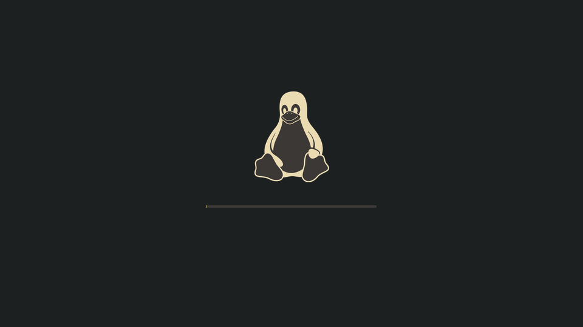
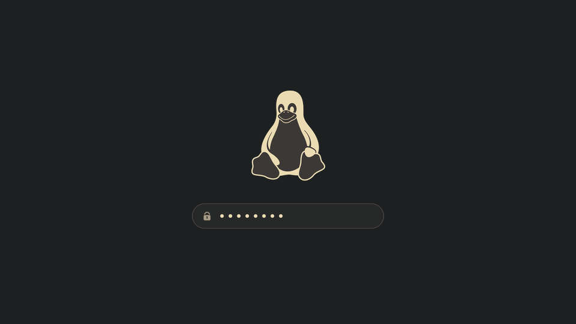

# 🐧 Minima Plymouth Theme

Minimalist Gruvbox boot theme for Plymouth.

-----

## 🖼️ Previews

### 🔄 Boot Splash


### 🔐 LUKS Decryption


-----

## 🛠️ Installation

### 🚀 Quick Install (via script)

```bash
git clone https://github.com/koresent/minima-plymouth-theme.git
cd minima-plymouth-theme
chmod +x install.sh
sudo ./install.sh
```

The script copies files to `/usr/share/plymouth/themes/minima/`, sets it as the default theme, and rebuilds the initramfs (`mkinitcpio`, `dracut`, `update-initramfs`, or `booster`).

### 🐧 Manual Install by Distribution

#### Arch Linux

1. Ensure `plymouth` hook is present in `/etc/mkinitcpio.conf`:
   ```bash
   HOOKS=(base udev plymouth autodetect modconf kms keyboard keymap consolefont block encrypt filesystems fsck)
   ```
2. Copy the theme:
   ```bash
   sudo mkdir -p /usr/share/plymouth/themes/minima
   sudo cp -r minima.plymouth minima.script assets /usr/share/plymouth/themes/minima/
   ```
3. Set the theme and rebuild:
   ```bash
   sudo plymouth-set-default-theme -R minima
   ```

#### Fedora / RHEL

```bash
sudo mkdir -p /usr/share/plymouth/themes/minima
sudo cp -r minima.plymouth minima.script assets /usr/share/plymouth/themes/minima/
sudo plymouth-set-default-theme -R minima
sudo dracut --force
```

#### Ubuntu / Debian / Linux Mint

```bash
sudo mkdir -p /usr/share/plymouth/themes/minima
sudo cp -r minima.plymouth minima.script assets /usr/share/plymouth/themes/minima/
sudo update-alternatives --install /usr/share/plymouth/themes/default.plymouth default.plymouth /usr/share/plymouth/themes/minima/minima.plymouth 100
sudo update-alternatives --set default.plymouth /usr/share/plymouth/themes/minima/minima.plymouth
sudo update-initramfs -u
```

### 🧪 Preview without Rebooting

```bash
chmod +x scripts/preview.sh
sudo ./scripts/preview.sh 6

# Test passphrase prompt:
sudo ./scripts/preview.sh 6 /dev/tty --test-dialog
```

-----

## ⚙️ Customization

To regenerate assets or tweak colors:
1. Replace `src/tux.png` if using a custom logo.
2. Edit color values in `scripts/generate_assets.py`.
3. Run:
   ```bash
   python3 scripts/generate_assets.py
   sudo ./install.sh
   ```

-----

## 🗑️ Uninstallation

```bash
chmod +x uninstall.sh
sudo ./uninstall.sh
```
